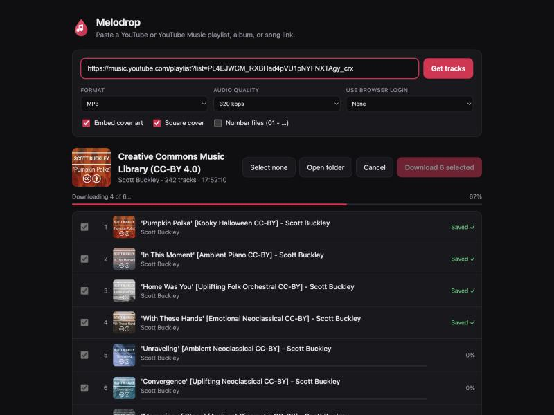
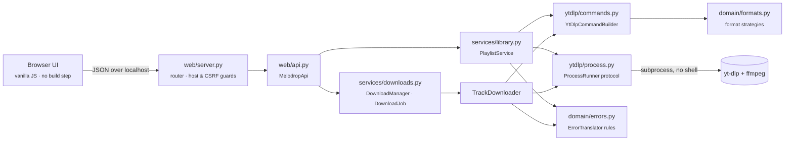

<p align="center">
  
</p>

<h1 align="center">Melodrop</h1>

<p align="center">
  <strong>Paste a playlist. Get your music.</strong><br>
  A clean, local web app that turns YouTube and YouTube Music playlists into
  tagged, cover-art-ready MP3s — one click, the whole album.
</p>

<p align="center">
  <a href="https://github.com/filipeteotonio/melodrop/actions/workflows/ci.yml"></a>
  
  
  
  
  <a href="LICENSE"></a>
</p>

<p align="center">
  <picture>
    <source media="(prefers-color-scheme: light)" srcset="docs/screenshot-light.png">
    
  </picture>
</p>

<p align="center"><em>macOS · Linux · Python standard library only · MIT</em></p>

---

## Why Melodrop?

Online "playlist downloader" sites are slow, full of ads, cap you at a few songs,
and send your listening habits to someone else's server. Melodrop is the same
idea running **on your own machine**, built on the open-source
[yt-dlp](https://github.com/yt-dlp/yt-dlp):

- 🎧 **Whole playlists, albums, mixes or single songs.** Works with `youtube.com` and `music.youtube.com` links.
- ✅ **Pick what you want.** Every track is listed with its artwork and length. Untick the ones you don't need.
- 🎚️ **Your format, your quality.** MP3, M4A/AAC, Opus, FLAC, WAV, or MP4 video up to 4K. MP3 goes up to 320 kbps.
- 🖼️ **Library-ready files.** Artist and title tags plus embedded album art, cropped to a square like a real cover.
- ⚡ **Parallel downloads with live progress.** One bar per track, one bar for the whole batch, and a cancel button.
- 🛡️ **Gets past "Sign in to confirm you're not a bot".** Uses your browser's YouTube login, paces its requests, and gives you a **Retry failed** button.
- 🔒 **Private by design.** Runs on `localhost` only, with no account and no tracking.

---

## Quick start

**1. Install the engines** (one time):

```bash
brew install yt-dlp ffmpeg deno
```

> `yt-dlp` downloads, `ffmpeg` converts and tags, `deno` is the JavaScript runtime yt-dlp now needs for YouTube.
> On Linux, use your package manager or `pip install yt-dlp`.

**2. Get Melodrop and run it:**

```bash
git clone https://github.com/filipeteotonio/melodrop.git
cd melodrop
python3 -m melodrop
```

Your browser opens at **http://127.0.0.1:8765**. On macOS you can also just
double-click **`start.command`**, which installs anything missing first.

<details>
<summary>Prefer a real <code>melodrop</code> command?</summary>

```bash
pip install .
melodrop --help
```

There are no runtime dependencies to pull in: the package is pure standard library.
</details>

---

## How to use it

1. **Paste a link**: a playlist, an album, a mix or a single song.
2. **Choose a format.** The default is MP3 at 320 kbps with cover art.
3. **Click Download.** Files land in `~/Downloads/YouTube Music/<playlist name>/`. Click **Open folder** to jump there.

| Format | Kind | Quality options | Cover art |
|---|---|---|:---:|
| **MP3** | audio | 128–320 kbps | ✅ |
| **M4A / AAC** | audio | 128–320 kbps | ✅ |
| **Opus** | audio | 128–320 kbps | ✅ |
| **FLAC** | lossless audio | – | ✅ |
| **WAV** | lossless audio | – | – |
| **MP4** | video | 360p → 4K | ✅ |

### "Sign in to confirm you're not a bot"

YouTube sometimes blocks anonymous downloads. When that happens, Melodrop says
so in plain words and highlights the fix:

1. Under **Use browser login**, pick a browser where you're signed in to YouTube (Chrome and Firefox are the easiest).
2. Click **Retry failed**. Only the songs that failed are downloaded again.

On macOS, Chrome asks for keychain access the first time; click **Always Allow**.
Safari needs Full Disk Access, so prefer Chrome or Firefox.

---

## Architecture

Melodrop is small, but it's built like a production service: **pure domain
logic in the middle, side effects at the edges, and a single composition root**
that wires concrete classes together.



| Layer | Responsibility | I/O? |
|---|---|:---:|
| `domain/` | Models, validated options, format strategies, error rules, file naming | ❌ |
| `ytdlp/` | Builds command lines, parses JSON and progress output, runs processes | only `process.py` |
| `services/` | Use cases: read a playlist, run a download batch, open a folder | through interfaces |
| `web/` | Transport-free API object, tiny router, stdlib HTTP server, static UI | ✅ |
| `app.py` | Composition root: the only place concrete classes meet | – |

### SOLID, concretely

- **Single responsibility.** Building commands, parsing output, running processes, tracking job state and serving HTTP each live in their own module, and each is testable alone.
- **Open/closed.** A new output format is one `AudioFormat(...)` or `VideoFormat(...)` entry in the registry, and the UI picks it up from `/api/config`. A new friendly error message is one `ErrorRule`. No `if format == ...` chains anywhere.
- **Liskov substitution.** Every `MediaFormat` subclass honours the same `ytdlp_args(options)` contract, so callers never check which format they hold.
- **Interface segregation.** `ProcessRunner` and `RunningProcess` are small `Protocol`s with only what services need: `run`, `start`, `lines`, `wait`, `terminate`.
- **Dependency inversion.** Services depend on those protocols, not on `subprocess`. Tests inject fakes, and production injects `SubprocessRunner`, all wired in `app.py`.

### Security notes

A local web server that launches processes deserves care:

- Binds to **`127.0.0.1` only**, and rejects requests whose `Host` header isn't loopback. That blocks DNS-rebinding attacks.
- State-changing endpoints **require `Content-Type: application/json`**. That forces a CORS preflight, so a random website can't trigger downloads on your machine.
- Download links are resolved **inside the download folder only**, which stops path traversal like `/files/../../etc/passwd`.
- yt-dlp is called with an argument list and **never through a shell**. The browser name and every other option are checked against allow-lists.

---

## Development

```bash
make test       # 97 unit + integration tests (stdlib unittest, no installs needed)
make lint       # ruff check + format check
make coverage   # branch coverage report (~98%)
make run        # start the app
```

The test suite never touches the network or YouTube. A `FakeRunner` stands in at
the process boundary, so everything above it is exercised for real: command
building, parsing, the threaded job manager, the API, and a live HTTP server on
a random port.

| Test module | What it covers |
|---|---|
| `test_domain.py` | Options validation, format strategies, error rules, safe file names |
| `test_ytdlp.py` | Command lines, progress/JSON parsing, the real `subprocess` adapter |
| `test_services.py` | Playlist reading, parallel downloads, failures, cancellation, concurrency limit |
| `test_web.py` | API contract, router, path traversal, host and content-type guards, full HTTP flow |
| `test_cli.py` | Flags and environment variables, dependency checks, startup and shutdown |

CI runs lint and the full suite on Python 3.9 → 3.13, on Linux and macOS.

<details>
<summary>Project layout</summary>

```
melodrop/
├── melodrop/
│   ├── domain/          # pure logic: models, options, formats, errors, naming
│   ├── ytdlp/           # yt-dlp command builder, output parser, process adapter
│   ├── services/        # playlist reading, download jobs, folder opener
│   ├── web/             # API, router, HTTP server, static UI (HTML/CSS/JS)
│   ├── app.py           # composition root
│   ├── cli.py           # `melodrop` entry point
│   └── config.py        # flags + environment variables
├── tests/               # unittest suite with fakes at the process boundary
├── docs/                # logo and screenshots
└── start.command        # double-click launcher for macOS
```
</details>

### Configuration

| Flag | Environment variable | Default |
|---|---|---|
| `--port` | `MELODROP_PORT` | `8765` |
| `--download-dir` | `MELODROP_DOWNLOAD_DIR` | `~/Downloads/YouTube Music` |
| `--parallel` | `MELODROP_PARALLEL` | `2` tracks at a time (1–8) |
| `--no-browser` | – | opens the browser on start |

If downloads suddenly stop working, YouTube probably changed something. Update the engine:

```bash
brew upgrade yt-dlp
```

---

## Responsible use

Melodrop is a front end for yt-dlp, made for content you have the right to
download: your own uploads, Creative Commons and public-domain music, or
anything the rights holder lets you save. Respect copyright and YouTube's Terms
of Service. Melodrop is not affiliated with YouTube or Google.

The screenshots show Scott Buckley's
[Creative Commons (CC-BY 4.0) music library](https://www.youtube.com/playlist?list=PL4EJWCM_RXBHad4pVU1pNYFNXTAgy_crx).

## License

[MIT](LICENSE) © 2026 Filipe Teotonio
